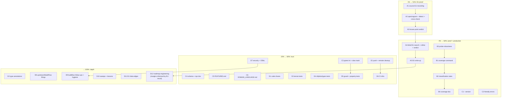

# Pareto Execution Plan: EU-proof the product, then make it trustworthy

> [!NOTE]
> Drafted by GLM (glm-5.3-flash) via Crush on 2026-11-14 00:42 CET from the
> harvested backlog (TODO_LIST.md @ `76fd2e1`), ROADMAP.md, and this session's
> four annotated status reports. Not yet reviewed by @Lars Artmann.

## Context

`dopplertrack` locates where an audio recording was made by matching Doppler
sweeps of propeller flyovers against historical ADS-B tracks. State after the
2026-11-13 session: upstream 0.3.0 synced (nationwide search, verdict.py,
ridge scoring), data path verified EU-ready (2,034 Germany-bbox traces in one
day's archive, terrain + geodesy check out), all quality gates green
(pytest 49/3/2, docs-gates 5/5, buildflow exit 0), single backlog in
TODO_LIST.md (27 rows). What is missing: proof that the *product* (not just
the data path) works on a European recording; stranger-facing UX; and a long
tail of hygiene. This plan ranks all of it.

Errata (Step 0 check): every TODO_LIST row was verified open during this
session's harvest — nothing here re-dispatches shipped work. The only
uncommitted tree change is `.github/workflows/release.yml` (action bump
v3.0.3→v3.0.4, provenance unknown, owner question pending — task E0.2).

## Pareto breakdown

| Tier | Share of work | Delivers | Tasks |
| --- | --- | --- | --- |
| **1%** | ~3 h of ~90 h | **51% of the result**: one EU recording geolocated end-to-end. Converts "the data path is EU-ready" into "the product works in EU" — it exercises detect, fit, search, verdict, and EU feed density in a single proof, and unblocks every EU claim in the README. | A1–A3 |
| **4%** | ~8 h | **64%**: the 1% plus the blind EU search with verdict, the write-up that makes the result durable, the `coverage` command (EU readiness quantified for *any* bbox), and `--version` + friendly CLI errors (a stranger's first run doesn't crash cryptically). | A4–A5, B1–B2, C1–C2 |
| **20%** | ~20 h | **80%**: the 4% plus documentation a contributor needs (schema, FEATURES, DOMAIN_LANGUAGE), core test gaps (terrain, CLI, plots, network-I/O guard), CI caching/badge, the security scan pass, the ODbL license answer, and pushing the work so it exists publicly. | C3–C6, D1, D3–D6, D8, D10, D12, E1 |
| **remaining 80% → 100%** | ~70 h | Type annotations, property tests, upstream/BuildFlow filings, hygiene batches, EU data-edge verifications, roadmap engineering (margins, auto-chain, prefetch), personal-process items. | D2, D7, D9, D11, E2–E5, F1–F6, P1–P8 |

## Master plan (30–100 min tasks, priority order)

| # | ID | Task | Tier | Impact | Effort | Customer value | Depends on |
| --- | --- | --- | --- | --- | --- | --- | --- |
| 1 | A1 | Source an EU recording with published location + date (livestream/archive candidates, adsb.lol archive availability) | 1% | High | 60m | High | — |
| 2 | A2 | Spectrogram + `detect` on it, cross-check candidates against EU day-index flights, fit two events | 1% | High | 100m | High | A1 |
| 3 | A3 | Known-point scoring + verdict at the truth | 1% | High | 60m | High | A2 |
| 4 | A4 | Blind EU search + refine (+`--extra`) + verdict, artifacts into docs/results | 4% | High | 100m | High | A3 |
| 5 | A5 | EU results write-up (experiments/results, README row, AGENTS EU paragraph) | 4% | High | 45m | Med | A4 |
| 6 | B1 | `coverage DATE BBOX` command: port the probe, per-country aggregation | 4% | High | 100m | Med | — |
| 7 | B2 | Classification-rate stats (`is_prop` at scale, unknown-designator rate) + tests | 4% | Med | 60m | Med | B1 |
| 8 | B3 | Probe robustness: `_ChainedHTTP` reader, `.ab` chain, live progress | 4% | Med | 45m | Low | — |
| 9 | B4 | docs/coverage.md: method + EU numbers table | 4% | Med | 30m | Med | B2 |
| 10 | C1 | `--version` flag + test | 4% | Med | 30m | Med | — |
| 11 | C2 | Friendly CLI errors (missing ffmpeg, bad JSON, missing file) + tests | 4% | Med | 60m | High | — |
| 12 | C3 | `[tool.pytest.ini_options]` + slow marker for the synthetic suite | 20% | Med | 30m | Low | — |
| 13 | C4 | EventFit JSON schema + Spectrogram/Trace/DayIndex .npz specs | 20% | Med | 60m | Med | — |
| 14 | C5 | FEATURES.md (honest inventory, computed counts) | 20% | Med | 45m | Med | — |
| 15 | C6 | docs/DOMAIN_LANGUAGE.md (Doppler, ENU, CPA, emission time, whitening, ridge, locked scoring, silence filter) | 20% | Med | 60m | Med | — |
| 16 | D1 | Code chores: hello() removal, soundfile removal (uv lock), fixture rename .json.gz | 20% | Med | 60m | Low | — |
| 17 | D3 | terrain.py tests (mocked HTTP: correctness, cache, prefetch) | 20% | Med | 60m | Low | — |
| 18 | D4 | cli.py parsing tests + plots Agg smoke + AircraftTypes offline test | 20% | Med | 60m | Low | — |
| 19 | D5 | Network-I/O guard test + property tests for pair-join edges + coverage weighting | 20% | Med | 100m | Low | C3 |
| 20 | D6 | CI infra: uv cache, badge, pytest pinning, actionlint, release dry-run | 20% | Med | 60m | Low | E1 |
| 21 | D7 | Security + license: gitleaks/codespell/markdown-lint scans, nosec policy, ODbL DATA_LICENSE note | 20% | High | 100m | Med | — |
| 22 | E1 | Push main to origin, delete origin/upstream-pr | 20% | High | 15m | Med | — |
| 23 | D2 | Type-annotate remaining public functions | 100% | Low | 100m | Low | — |
| 24 | D8 | Upstream/BuildFlow: PR #6 outcome, bandit-parser investigation, file issues (verify-before-filing + github-voice), PR template check | 100% | Med | 100m | Med | — |
| 25 | D9 | BuildFlow follow-ups + repo hygiene bundle + CHANGELOG fork-local entry | 100% | Low | 100m | Low | D7 |
| 26 | D10 | Sweeps + lessons: old-report annotate, gh search/NO_COLOR re-verify, crush-config lesson, insteadOf quirk | 100% | Low | 60m | Low | E1 |
| 27 | D11/D12/F* | EU data edges (mlatonly pod, >60°N terrain, retention) + roadmap engineering spike (margins, auto-chain, progress, prefetch, repro rerun, >2-event design) | 100% | Med | 100m+ | Med | A4 |

Roadmap ideas deliberately NOT scheduled as engineering tasks (they are
design-first): >2-event search generalization and results reproducibility
rerun stay in ROADMAP.md until A4/A5 produce evidence worth building on.

## Micro plan (≤12 min tasks, priority order)

### Phase A — EU proof (the 1% → 51%)

| ID | Micro-task | Min |
| --- | --- | --- |
| A1.1 | List EU candidate recordings (livestreams/archives with published location) | 20 |
| A1.2 | Verify candidate date/time and that the archive is downloadable | 12 |
| A1.3 | Pick primary + backup; record coordinates, date, mic description | 12 |
| A1.4 | Confirm adsb.lol globe_history archive exists for that date | 12 |
| A2.1 | Decode recording → spectrogram .npz | 12 |
| A2.2 | Run `detect`; capture ranked candidate table | 12 |
| A2.3 | `fetch` the EU day index for the date | 12 |
| A2.4 | Cross-check top candidates vs prop flights within 12 km | 20 |
| A2.5 | Pick two events; `fit` both with harmonics | 20 |
| A2.6 | Check second harmonic; adjust band if needed | 12 |
| A2.7 | Note findings (candidates, times, flights) | 12 |
| A3.1 | `search --point` at the true location | 12 |
| A3.2 | Compute verdict p at truth | 12 |
| A3.3 | Plot modelled curves at truth | 12 |
| A3.4 | Compare margins vs Oyster Bay/eagle cam baselines | 12 |
| A3.5 | Record the known-point verdict in session notes | 12 |
| A4.1 | Configure box/nationwide search for the site | 12 |
| A4.2 | Run search; capture wall time + top table | 12 |
| A4.3 | Analyze best-per-pair CSV | 12 |
| A4.4 | `refine` at 50 m | 12 |
| A4.5 | Add `--extra` detected events if available | 12 |
| A4.6 | Compute verdict on the refined result | 12 |
| A4.7 | Write result tables into docs/results | 12 |
| A4.8 | Render score/curve PNGs | 12 |
| A5.1 | Write the EU recording story into docs/experiments.md | 12 |
| A5.2 | Add README results row | 12 |
| A5.3 | Update AGENTS.md EU paragraph (validation no longer "not yet done") | 12 |
| A5.4 | docs-gates + buildflow + commit | 9 |

### Phase B — coverage tooling (→ 64%)

| ID | Micro-task | Min |
| --- | --- | --- |
| B1.1 | Port the streaming probe into fetch.py as a reusable iterator | 12 |
| B1.2 | Scaffold `coverage` CLI subcommand | 12 |
| B1.3 | Aggregation: traces-in-bbox counts, parse-failure counts | 12 |
| B1.4 | Per-country grouping via registration prefix | 12 |
| B1.5 | Prop-rate + unknown-designator rate via AircraftTypes | 12 |
| B1.6 | Tests against a small fixture tar | 20 |
| B1.7 | README data-sources mention of `coverage` | 12 |
| B1.8 | Gates + commit | 8 |
| B2.1 | `is_prop`-at-scale stats function | 12 |
| B2.2 | Unknown-designator listing in output | 12 |
| B2.3 | Tests for the stats path | 12 |
| B2.4 | Wire stats into `coverage` output | 12 |
| B2.5 | EU rates table into docs | 12 |
| B3.1 | Swap probe reader to `_ChainedHTTP` (Range resume) | 12 |
| B3.2 | Handle the `.aa`+`.ab` asset chain | 12 |
| B3.3 | Live progress callback (no buffered-tail loss) | 12 |
| B3.4 | Move probe script into scripts/ | 9 |
| B4.1 | Write docs/coverage.md (method + caveats) | 12 |
| B4.2 | EU numbers table (from the 2026-11-13 probe) | 10 |
| B4.3 | Link coverage.md from README | 8 |

### Phase C — stranger-facing UX & docs (→ 80%)

| ID | Micro-task | Min |
| --- | --- | --- |
| C1.1 | `--version` via importlib.metadata | 12 |
| C1.2 | Test for --version | 8 |
| C1.3 | Gates + commit | 10 |
| C2.1 | Friendly error: ffmpeg missing | 12 |
| C2.2 | Friendly errors: bad JSON, missing file | 12 |
| C2.3 | Wrap CLI main error paths | 12 |
| C2.4 | Tests for each error path | 12 |
| C2.5 | Gates + commit | 12 |
| C3.1 | Add [tool.pytest.ini_options] with markers | 12 |
| C3.2 | Mark the ~5 min synthetic test `slow` | 8 |
| C3.3 | Verify `-m "not slow"` fast loop | 10 |
| C4.1 | EventFit JSON schema (fields, units, time bases) | 20 |
| C4.2 | Spectrogram .npz spec (t/f/S) | 12 |
| C4.3 | Trace/DayIndex .npz spec | 12 |
| C4.4 | Place + link the schema doc | 16 |
| C5.1 | Inventory pipeline stages with evidence paths | 12 |
| C5.2 | Status rows (FULLY_FUNCTIONAL etc., computed counts) | 12 |
| C5.3 | Commands/UX rows | 12 |
| C5.4 | Gates + commit | 9 |
| C6.1 | Glossary skeleton | 12 |
| C6.2 | Doppler, ENU, CPA entries | 12 |
| C6.3 | Emission vs observation time entry | 12 |
| C6.4 | Whitening, ridge, locked scoring, silence filter entries | 16 |
| C6.5 | Link from README | 8 |

### Phase D — quality, security, upstream (→ 100%)

| ID | Micro-task | Min |
| --- | --- | --- |
| D1.1 | Remove hello(); adjust any references | 12 |
| D1.2 | `uv remove soundfile` + `uv lock` | 12 |
| D1.3 | Rename fixture to .json.gz (test + dprint exclude) | 12 |
| D1.4 | Full suite verification | 12 |
| D1.5 | Commit | 12 |
| D2.1 | Annotate adsb.py public functions | 20 |
| D2.2 | audio.py annotations | 12 |
| D2.3 | doppler.py annotations | 12 |
| D2.4 | geo.py annotations | 12 |
| D2.5 | terrain.py annotations | 12 |
| D2.6 | fetch.py annotations | 12 |
| D2.7 | score.py/verdict.py annotations | 20 |
| D3.1 | Mocked-HTTP fixture for tiles | 12 |
| D3.2 | Elevation correctness test | 12 |
| D3.3 | Disk+memory cache test | 12 |
| D3.4 | Prefetch test | 12 |
| D3.5 | Gates + commit | 12 |
| D4.1 | CLI parser tests: bbox/version/errors | 12 |
| D4.2 | fetch/search arg tests | 12 |
| D4.3 | plots Agg smoke test | 12 |
| D4.4 | AircraftTypes offline fixture test | 12 |
| D4.5 | Gates + commit | 12 |
| D5.1 | Network-guard fixture (block sockets) | 12 |
| D5.2 | Guard test: suite performs no network I/O | 12 |
| D5.3 | Hypothesis install decision | 12 |
| D5.4 | Pair-join edge property tests | 20 |
| D5.5 | Coverage weighting for score/search paths | 12 |
| D5.6 | Run + read coverage report | 12 |
| D5.7 | Gates + commit | 20 |
| D6.1 | uv cache GitHub Action step | 12 |
| D6.2 | CI badge on README | 12 |
| D6.3 | pytest invocation pinning decision | 12 |
| D6.4 | actionlint on release.yml | 12 |
| D6.5 | workflow-dispatch dry run | 12 |
| D7.1 | gitleaks scan + triage | 12 |
| D7.2 | codespell scan + triage | 12 |
| D7.3 | markdown-lint scan + triage | 12 |
| D7.4 | nosec policy decision for audio.py (written) | 12 |
| D7.5 | ODbL assessment for adsb.lol-derived artifacts | 12 |
| D7.6 | DATA_LICENSE/attribution note if needed | 12 |
| D7.7 | Scheduled-gitleaks decision | 12 |
| D7.8 | Gates + commit | 16 |
| D8.1 | Upstream PR #6 outcome check | 12 |
| D8.2 | Locate bandit stdout splitter in BuildFlow source | 12 |
| D8.3 | Reproduce the findings-count artifact locally | 12 |
| D8.4 | Reproduce the "missing identity fields" warning | 12 |
| D8.5 | verify-before-filing gates on both findings | 12 |
| D8.6 | Draft + file via github-voice (repo: BuildFlow) | 24 |
| D8.7 | Upstream PR template/CONTRIBUTING check | 12 |
| D9.1 | dprint excludes survive `buildflow upgrade` test | 12 |
| D9.2 | Itemize unavailable tools for a Python repo | 12 |
| D9.3 | pyupgrade equivalents evaluation | 12 |
| D9.4 | Vulture whitelist file decision | 12 |
| D9.5 | Split-brain register: fleet vs per-repo config | 12 |
| D9.6 | Doctor cadence + budgets + interrogate decisions | 12 |
| D9.7 | Hygiene: gitignore caches, link-scan exclusions, .crush dirs | 12 |
| D9.8 | pyproject URL fork-presence + docs/related.md | 12 |
| D9.9 | CHANGELOG fork-local entry + reformat-tool ID + insteadOf note | 16 |
| D10.1 | Push main to origin | 4 |
| D10.2 | Delete origin/upstream-pr (needs explicit OK) | 4 |
| D10.3 | Annotate remaining stale claims in older reports | 12 |
| D10.4 | Re-verify gh search flags + NO_COLOR habits | 12 |
| D10.5 | TRACE_PARSE_ERRORS lesson → crush-config commit | 12 |
| D10.6 | Old-report sweep completion + gates | 16 |

### Phase E/F — EU data edges + roadmap engineering (→ 100%)

| ID | Micro-task | Min |
| --- | --- | --- |
| D11.1 | mlatonly pod layout probe | 12 |
| D11.2 | mlatonly EU-usefulness note | 12 |
| D11.3 | Terrain above 60°N verification | 12 |
| D11.4 | Small-island tile verification | 12 |
| D11.5 | Retention question asked (issue/README/direct) | 12 |
| D12.1 | Score-margin experiment design (verdict-aware) | 12 |
| D12.2 | Margin experiment run on saved results | 12 |
| D12.3 | detect→search auto-chain spike | 12 |
| D12.4 | Progress printing before first 500 pairs | 12 |
| D12.5 | Terrain prefetch batching | 12 |
| D12.6 | docs/results reproducibility dry-run | 12 |
| D12.7 | >2-event search design note | 12 |
| D12.8 | Gates + commit | 16 |

### Personal process (Lars's checklists; no engineering time)

| ID | Item |
| --- | --- |
| P1 | Read the caller contract before writing a test |
| P2 | Re-view files after an in-place branch switch |
| P3 | Scoping statements at mandate-time, not report-time |
| P4 | `gh pr checks` right after filing |
| P5 | Batch fork-doc commits into a docs-train |
| P6 | Time-box "WHOLE LIST" mandates with an explicit range |
| P7 | Pin the upstream base commit in AGENTS.md on every sync |
| P8 | Keep docs/drafts/ + archived/ convention |

## Execution graph

## Verification

- Every master task ends with: `uv run pytest -q` (or `-m "not slow"` for
  fast loops), `NO_COLOR=1 docs-gates run .`, and `NO_COLOR=1 buildflow
  --build-mode fast` — all green before the commit.
- Phase A additionally ends with the verdict line (located/ambiguous/no
  match + p) recorded in docs/results and docs/experiments.md.
- Nothing lands in the historical reports un-annotated; TODO_LIST.md gets a
  new row the moment a task surfaces NEW work (HARVEST discipline).

## Standing decisions honored

- TODO_LIST.md remains the single living backlog; this plan is a
  point-in-time snapshot (docs-health ANNOTATE rules apply to it later).
- Upstream filings require the five verify-before-filing gates +
  github-voice (D8 is the only filing task in this plan).
- `release.yml` (action bump, provenance unknown) stays uncommitted
  pending the owner's answer; excluded from every commit until then.
